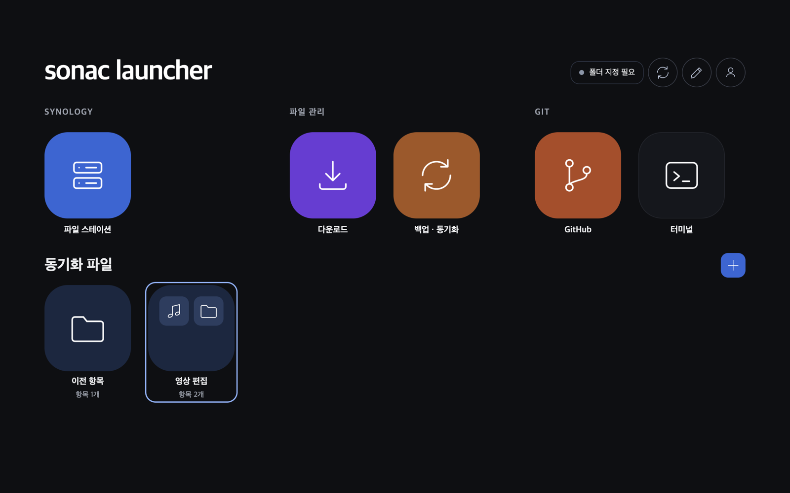

# 소낙 런처 - sonac launcher

Synology NAS에 로그인해 파일 관리를하고 같은 파일을 여러 기기에 똑같이 동기화 하여 같은 개발 / 영상 편집 환경을 구축하는 Windows·macOS 데스크톱 앱입니다.

추후 외주 받은 웹페이지 백엔드 코드의 자동 업데이트와 관리 기능까지 추가하여 관리 프로그램으로 사용할 계획입니다.



## 설치

- Windows 64비트 Intel·AMD는 MSI를 실행합니다. 설치 후 시작 메뉴에서 **sonac launcher**를 실행합니다. 0.1.x EXE 설치본을 사용 중이면 Windows 설정에서 기존 앱을 제거한 다음 MSI를 설치하세요.
- Apple Silicon Mac에서는 DMG를 열고 **sonac launcher**를 **응용 프로그램** 폴더로 드래그합니다. 0.2.0 이상에서 GitHub 릴리스 업데이트를 확인합니다.

MSI와 DMG는 GitHub 릴리스에 게시합니다. [설치 파일](https://github.com/RedNoti/sonac_launcher/releases)

macOS에서 신뢰할 수 있는 테스트용 임시 서명본의 실행이 차단되면 최초 실행 시도 후 **시스템 설정 → 개인정보 보호 및 보안 → 그래도 열기**를 사용합니다. 공개 배포에는 Developer ID Application 서명과 Apple 공증을 사용합니다. [Apple의 앱 실행 안내](https://support.apple.com/ko-kr/102445)

## 로그인과 파일 전송

1. 처음에는 **Synology NAS 등록**에서 연결 이름과 DSM 주소를 입력합니다. 호스트 이름만 입력해도 HTTPS로 연결합니다. DSM 계정으로 로그인하면 공유 폴더 접근 권한이 적용됩니다. DSM이 2단계 인증을 요구할 때 인증 코드 입력란이 나타납니다.
2. 등록한 NAS는 이름으로 선택합니다. 주소를 바꾸려면 연필 아이콘을 누릅니다. 여러 NAS를 사용하려면 **다른 Synology 추가**를 선택하고, 로그인한 뒤에는 **계정 및 연결 → NAS 전환**에서 다른 NAS를 선택할 수 있습니다. 동기화 설정은 NAS 계정별로 저장합니다.
3. 홈 화면에서 **파일 스테이션**을 열고 상단 버튼으로 격자와 목록을 전환합니다. 폴더는 더블 클릭하거나 **폴더 열기**로 들어갑니다. 전송 중 작업 줄 오른쪽의 아이콘에 마우스를 올리면 파일명, 진행률, 전송 속도를 확인할 수 있습니다.

Synology 파일 전송은 런처 안에서 File Station API로 처리됩니다. 연결하려면 해당 PC에서 DSM HTTPS 주소에 도달할 수 있어야 하고, DSM 계정에 File Station과 공유 폴더 권한이 있어야 합니다. 업로드에는 쓰기 권한이 필요합니다. 인증서 오류가 표시되면 인증서에 등록된 호스트 이름으로 접속하고 해당 인증서의 발급 체인을 확인합니다. [Synology DSM 로그인 API](https://kb.synology.com/ko-kr/DG/DSM_Login_Web_API_Guide/3) · [File Station API](https://global.download.synology.com/download/Document/Software/DeveloperGuide/Package/FileStation/All/enu/Synology_File_Station_API_Guide.pdf)

- 파일 하나를 선택하고 **스페이스바**를 누르면 미리보기가 열립니다. 더블 클릭 또는 상단 눈 모양 버튼으로도 이미지, 지원되는 오디오와 동영상, PDF, Word DOCX 본문, 텍스트를 앱 안에서 볼 수 있습니다.
- Mac은 **⌘ 클릭**, Windows는 **Ctrl 클릭**으로 개별 선택을 추가합니다. **Shift 클릭**은 범위를 선택합니다. 선택 항목의 상단 아이콘과 우클릭 메뉴에서 일괄 다운로드하거나 삭제할 수 있습니다. 로컬 삭제는 휴지통으로 이동하고, 저장소 삭제는 해당 저장소의 삭제 정책을 따릅니다.
- **터미널**을 누르면 런처의 터미널 페이지에서 Mac의 로그인 셸 또는 Windows PowerShell을 사용할 수 있습니다. **홈**을 누르면 터미널 세션이 종료됩니다.
- 터미널 상단 **저장한 명령어**에서 자주 쓰는 명령어를 분류별로 저장할 수 있습니다. 명령어 이름을 누르면 터미널에 입력되며, Enter를 누르면 실행됩니다. 연필 아이콘을 눌러 이름, 분류, 명령어를 수정하거나 삭제할 수 있습니다.

## 여러 PC에서 파일 받기

1. 모든 PC에서 같은 Synology NAS에 같은 계정으로 로그인합니다. PC를 재시작한 뒤에도 자동으로 연결하려면 **이 PC에서 로그인 유지**를 선택합니다. 로그아웃하면 다음 로그인까지 자동 연결을 멈추며, 저장된 비밀번호로 다시 로그인할 수 있습니다.
2. 각 PC에서 **백업 · 동기화**를 열고 같은 **클라우드 폴더**와 각 PC에서 사용할 저장 위치를 고릅니다.
3. 자동 확인 간격은 기본 5분입니다. **지금 동기화**로 즉시 확인할 수 있습니다. 네트워크가 다시 연결되거나 절전에서 깨어나면 NAS 연결을 확인하고 동기화를 재개합니다. macOS에서 메뉴 막대 아이콘은 아이콘 메뉴에서 숨길 수 있고, 앱의 **보기 → 메뉴 막대 아이콘 표시**에서 다시 켤 수 있습니다. 아이콘을 숨기고 창을 닫아도 앱이 실행 중이면 자동 동기화가 이어집니다.
4. 프로필 옆의 연필 버튼으로 GitHub 주소를 편집합니다. 다른 PC에서도 사용하려면 저장할 때 NAS에 게시합니다. 이전에 서명 검증을 설정한 폴더에서는 서명 목록도 갱신합니다.

일반 파일은 클라우드에서 이 PC로만 동기화됩니다. 이름이 같은 기존 파일은 보존합니다. 홈 화면의 **다운로드**에서 이 PC의 동기화 폴더를 탐색할 수 있습니다. 동기화 폴더를 설정하기 전에는 기본 다운로드 폴더가 표시됩니다. 프로필 옆 상태가 **완료**이면 클라우드에서 추가로 받을 항목이 없습니다.

## GitHub 프로젝트와 동기화 영역

- **GitHub** 타일에서 Fine-grained 개인 액세스 토큰을 입력합니다. 토큰을 만들 때 접근할 저장소를 선택하고 **Contents**를 읽기 전용으로 설정합니다. 연결한 뒤 볼 프로젝트를 골라 목록에 추가하면 기본 브랜치의 최신 커밋을 확인할 수 있습니다. [GitHub 토큰 설정 안내](https://docs.github.com/en/authentication/keeping-your-account-and-data-secure/managing-your-personal-access-tokens)
- 홈의 **동기화 파일**에서 **+**를 눌러 ‘영상’ 같은 영역을 만듭니다. 영역을 열고 안쪽 **+**를 눌러 ‘음악’이나 ‘밈’ 같은 항목을 추가합니다. 항목마다 NAS 폴더나 GitHub 저장소, 이 PC의 저장 폴더를 선택합니다.
- NAS 항목마다 자동 또는 수동 동기화를 설정할 수 있습니다. 여러 NAS 항목에 같은 로컬 폴더를 지정하면 차례로 동기화하며 기존 파일을 보존합니다. 항목 설정에서 다른 영역으로 이동할 수도 있습니다.
- GitHub 영역에서 저장소와 브랜치를 고른 뒤 **최신 파일 적용**을 누르면 최신 커밋에서 받은 파일로 같은 경로의 로컬 파일을 덮어씁니다. 원격에서 삭제된 파일과 로컬에만 있는 파일은 보존됩니다. GitHub 영역은 수동으로 실행합니다.

## 서버 업데이터

런처 로그인 첫 화면의 주황색 **서버 업데이터** 타일을 누르면 전용 로그인 화면이 열립니다. 기존 HTTPS 배포 설정은 보존되며, 실행은 전용 인증 서비스 연결 전까지 일시 중지됩니다.

## 자동 업데이트 배포

GitHub Releases 태그는 알파 `a0.2.3`, 베타 `b0.2.3`, 정식 `R0.2.3` 형식을 사용합니다. 빌드에 `SONAC_RELEASE_CHANNEL=a` 또는 `b`를 지정하면 해당 채널로 빌드되며, 기본값은 `R`입니다. 빌드의 채널과 버전에 맞는 태그에 MSI, DMG, `latest-mac-arm64.json`, `latest-win-x64.json`을 올립니다. 알파와 베타는 프리릴리스로 게시할 수 있습니다. [GitHub 릴리스 관리](https://docs.github.com/en/repositories/releasing-projects-on-github/managing-releases-in-a-repository)

`a0.2.10`부터 자동 업데이트는 숫자가 세 부분에서 다섯 부분까지 있는 버전 태그를 인식합니다. 네 부분 이상인 릴리스를 빌드하려면 `package.json`의 `releaseVersion`에 표시 버전을 지정하고, `version`에는 이전 설치본보다 높은 세 부분 버전을 지정합니다. `releaseVersion`을 생략하면 `version`을 사용합니다.

알파 설치본은 알파·베타·정식판, 베타는 베타·정식판, 정식은 정식판을 확인합니다. 같은 버전 번호에서는 더 안정적인 채널로만 이동합니다. 앱은 시작할 때와 실행 중 한 시간마다 확인하며, 로그인 화면에서도 수동으로 확인할 수 있습니다. 새 버전을 내려받아 검증한 뒤 **다시 시작**을 누르면 업데이트를 적용하고 앱을 다시 엽니다. 포크에서 배포하려면 빌드 전에 `SONAC_RELEASE_REPOSITORY=OWNER/REPO`를 지정합니다.

업데이트 서명 개인 키인 `.sonac-update-key.pem`을 비공개로 보관하고 후속 릴리스에도 같은 키를 사용합니다.

NAS에서는 동기화에 필요한 공유 폴더만 허용한 별도 계정을 사용하고, 다운로드 전용이면 읽기 권한만 부여합니다. 외부에서 DSM에 접속할 때는 VPN을 사용할 수 있습니다. [Synology 보안 설정](https://kb.synology.com/en-us/DSM/tutorial/How_to_add_extra_security_to_your_Synology_NAS)

## 앱과 연결 보안

| 점검 범위 | 앱에서 적용한 보호 |
| --- | --- |
| NAS 로그인 및 통신 | TLS 1.2 이상, 서버 인증서와 호스트 이름 검증, 다른 URL로 이동하는 응답 차단. 관리자가 별도 경로로 전달한 서버 공개 키 지문을 추가로 고정할 수 있습니다. |
| 비밀번호와 GitHub 토큰 | 운영체제 보안 저장소로 암호화하고 로그인 계정·서버에 연결합니다. 저장된 비밀번호는 메인 프로세스에서만 사용합니다. 0.2.1로 처음 바꾸면 NAS 비밀번호와 GitHub 토큰을 한 번 다시 입력해야 합니다. |
| NAS 업로드 및 삭제 | NAS 로그인 후 DSM 계정 권한으로 쓰기 작업을 사용할 수 있습니다. 업로드·삭제·폴더 생성·런처 구성 게시 전에 서버와 경로를 표시하는 확인창이 열립니다. 현재 연결의 쓰기를 끄려면 **계정 및 연결**의 연필 아이콘을 누릅니다. |
| 앱 화면과 터미널 | 화면은 샌드박스에서 실행하고 외부 네트워크 접근을 차단합니다. 로컬 명령을 입력하는 터미널은 런처 안에서 격리된 화면과 전용 인터페이스를 사용합니다. |
| 업데이트 | 지정한 GitHub Releases에서 받은 목록의 서명과 설치 파일의 크기·SHA-256을 검증합니다. 정식 빌드의 Node 실행 모드와 디버그 옵션은 끕니다. |

NAS 공개 키 지문을 쓰려면 관리자가 신뢰할 수 있는 경로로 준 서버 인증서에서 아래 값을 계산하고, 앞에 `sha256/`를 붙여 로그인 창의 **NAS 인증서 공개 키 확인**에 입력합니다. 인증서를 갱신하면서 공개 키가 바뀌면 새 지문을 따로 확인한 뒤 변경합니다.

```sh
openssl x509 -in nas-cert.pem -pubkey -noout | openssl pkey -pubin -outform DER | openssl dgst -sha256 -binary | openssl base64 -A
```

NAS의 공유 폴더 접근 권한과 DSM 자체 보안은 NAS에서 관리합니다. 앱의 읽기 전용 설정은 런처가 쓰기 요청을 보내지 않게 합니다. NAS 계정에 실제 쓰기 권한이 필요 없다면 DSM에서도 읽기만 허용하세요. [Electron 보안 기준](https://www.electronjs.org/docs/latest/tutorial/security/)

## 소스에서 빌드

Node.js 20.19.5 이상과 `msitools`가 설치된 macOS에서 `npm ci`를 실행합니다. Windows 패키징에 쓰는 `wixl`과 `msibuild`는 `brew install msitools`로 설치할 수 있습니다. `npm run build`는 Apple Silicon DMG와 Windows x64 MSI를 만듭니다.

```sh
npm start
npm run check
npm test
npm run build
```

설치 파일은 `dist/`에 생성됩니다. 새 정식 버전의 빌드가 완료되면 같은 운영체제와 아키텍처의 이전 설치 파일을 삭제합니다. 빌드는 Electron 공식 릴리스에서 런타임을 가져오고 SHA-256을 검증합니다. 이미 받은 공식 ZIP 파일을 사용해 한 플랫폼을 빌드하려면 `SONAC_ELECTRON_ZIP`에 해당 파일 경로를 지정하고 `npm run build:mac` 또는 `npm run build:win`을 실행합니다.

### macOS 공개 배포 서명

Developer ID Application 인증서와 개인 키를 macOS 키체인에 설치합니다. Apple 인증 정보는 `xcrun notarytool store-credentials`로 키체인 프로필에 저장합니다. 아래 환경 변수로 빌드하면 Hardened Runtime 서명, DMG 공증, 티켓 첨부와 검증을 순서대로 실행합니다. [Apple 공증 안내](https://developer.apple.com/documentation/security/notarizing-macos-software-before-distribution)

```sh
SONAC_MAC_SIGN_IDENTITY='Developer ID Application: NAME (TEAMID)' \
SONAC_MAC_NOTARY_PROFILE='sonac-notary' npm run build:mac
```

### Tauri 미리보기

Tauri 시험판은 기존 홈 화면과 읽기 전용 예제 파일 탐색기를 시스템 WebView에서 실행합니다. 정식 설치본은 Electron이며 NAS 로그인, 파일 전송, 터미널, 업데이트를 제공합니다. [Tauri의 WebView 구성](https://v2.tauri.app/concept/process-model/)

```sh
node scripts/tauri-preview.mjs
cargo run --release --locked --manifest-path tauri-preview/Cargo.toml
```
