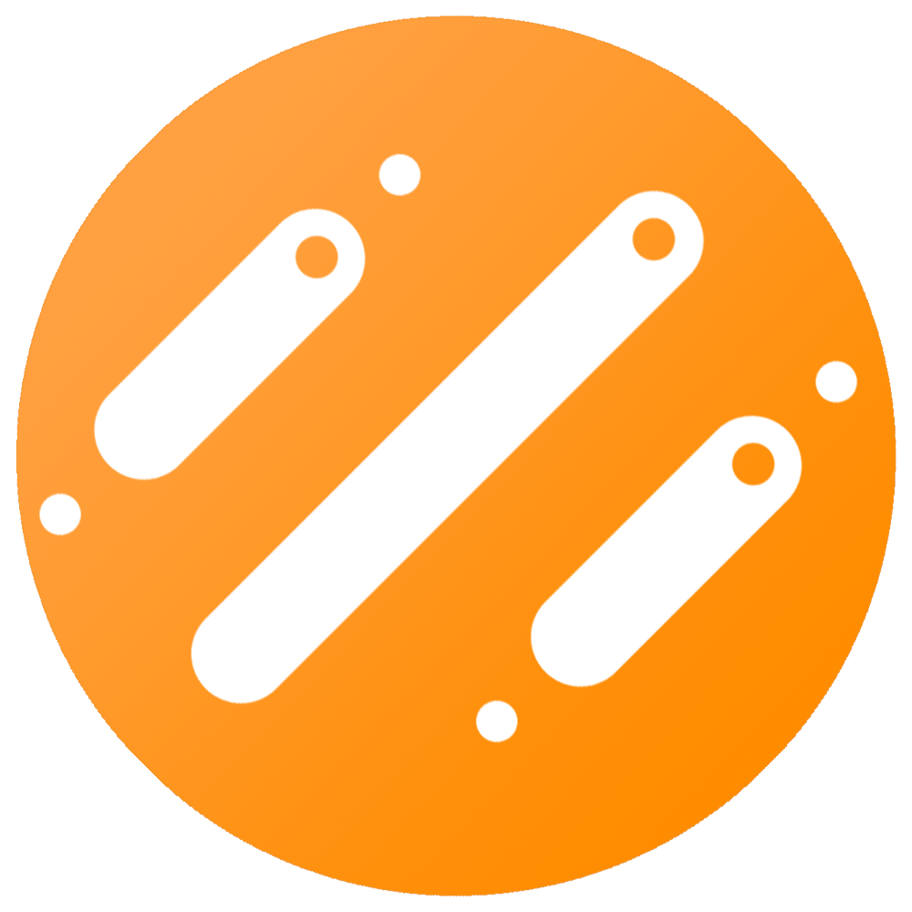

# sonac launcher

Synology NAS 또는 WebDAV 저장소에 로그인해 파일과 런처 바로가기를 여러 PC에서 사용할 수 있는 Windows·macOS 데스크톱 앱입니다.

## 설치

- Windows 64비트 Intel·AMD는 설치 프로그램을 실행합니다. 설치 후 시작 메뉴에서 **sonac launcher**를 실행합니다. [Windows 설치 프로그램](dist/sonac_launcher-0.1.9-win-x64-setup.exe)
- Apple Silicon Mac에서는 DMG를 열고 **sonac launcher**를 **응용 프로그램** 폴더로 드래그합니다. 자동 업데이트는 0.1.5부터 지원합니다. [Mac DMG](dist/sonac_launcher-0.1.9-mac-arm64.dmg)

이 빌드에는 Windows 배포 서명과 Apple 공증이 적용되어 있지 않습니다. macOS 앱은 로컬 테스트용으로 임시 서명했습니다. 운영체제 정책에 따라 첫 실행에 확인이 필요할 수 있습니다.

## 로그인과 파일 전송

1. **Synology NAS**를 선택하고 DSM의 직접 접속 주소를 입력합니다. 예시는 `https://nas.example.com:5001`입니다. NAS에 등록한 DSM 사용자 이름과 비밀번호로 로그인합니다. 인증 앱을 사용 중이면 **2단계 인증 사용**에서 OTP를 입력합니다.
2. 홈 화면에서 **파일 스테이션**을 누르면 앱 창 전체에서 공유 폴더를 탐색할 수 있습니다. 파일과 폴더는 기본으로 격자에 표시되며 상단 버튼에서 목록으로 전환할 수 있습니다. 폴더를 더블 클릭하거나 선택 후 **폴더 열기**로 이동합니다.
3. WebDAV 저장소를 쓸 때는 **WebDAV 클라우드**를 선택하고 HTTPS 접속 주소와 계정을 입력합니다. 로그인 후 **클라우드 파일**에서 파일을 전송할 수 있습니다.

Synology 파일 전송은 런처 안에서 File Station API로 처리됩니다. 연결하려면 해당 PC에서 DSM HTTPS 주소에 도달할 수 있어야 하고, DSM 계정에 File Station과 공유 폴더 권한이 있어야 합니다. 업로드에는 쓰기 권한이 필요합니다. 인증서 오류가 표시되면 인증서에 등록된 호스트 이름으로 접속하고 해당 인증서의 발급 체인을 확인합니다. [Synology DSM 로그인 API](https://kb.synology.com/ko-kr/DG/DSM_Login_Web_API_Guide/3) · [File Station API](https://global.download.synology.com/download/Document/Software/DeveloperGuide/Package/FileStation/All/enu/Synology_File_Station_API_Guide.pdf)

- 파일 하나를 선택하고 **스페이스바**를 누르면 미리보기가 열립니다. 더블 클릭 또는 상단 눈 모양 버튼으로도 이미지, 지원되는 오디오와 동영상, PDF, Word DOCX 본문, 텍스트를 앱 안에서 볼 수 있습니다.
- Mac은 **⌘ 클릭**, Windows는 **Ctrl 클릭**으로 개별 선택을 추가합니다. **Shift 클릭**은 범위를 선택합니다. 선택 항목의 상단 아이콘과 우클릭 메뉴에서 일괄 다운로드하거나 삭제할 수 있습니다. 로컬 삭제는 휴지통으로 이동하고, 저장소 삭제는 해당 저장소의 삭제 정책을 따릅니다.
- **터미널**은 Mac의 로그인 셸 또는 Windows PowerShell을 런처 창 안에 엽니다.

## 여러 PC에서 파일 받기

1. 모든 PC에서 같은 저장소와 계정으로 로그인합니다. PC를 재시작한 뒤에도 자동으로 연결하려면 **이 PC에서 로그인 유지**를 선택합니다.
2. 각 PC에서 **백업 · 동기화**를 열고 같은 **클라우드 폴더**와 각 PC에서 사용할 저장 위치를 고릅니다.
3. 자동 확인 간격은 기본 5분입니다. **지금 동기화**로 즉시 확인할 수 있습니다. 자동 동기화가 켜진 상태에서 창을 닫으면 메뉴 막대 또는 알림 영역에 남아 확인을 계속합니다. 앱을 완전히 종료하면 다음 실행과 로그인 후 확인을 재개합니다.
4. 프로필 옆의 연필 버튼으로 GitHub 주소를 편집합니다. 동기화 폴더가 연결되어 있으면 저장 시 `sonac-launcher.config.json`을 클라우드에 기록하고, 다른 PC가 다음 동기화에서 가져갑니다.

일반 파일은 클라우드에서 이 PC로만 동기화됩니다. 이름이 같은 기존 파일은 보존합니다. 홈 화면의 **다운로드**에서 이 PC의 동기화 폴더를 탐색할 수 있습니다. 동기화 폴더를 설정하기 전에는 기본 다운로드 폴더가 표시됩니다. 프로필 옆 상태가 **완료**이면 클라우드에서 추가로 받을 항목이 없습니다.

## GitHub 프로젝트와 동기화 영역

- **GitHub** 타일에서 Fine-grained 개인 액세스 토큰을 입력합니다. 토큰을 만들 때 접근할 저장소를 선택하고 **Contents**를 읽기 전용으로 설정합니다. 연결한 뒤 볼 프로젝트를 골라 목록에 추가하면 기본 브랜치의 최신 커밋을 확인할 수 있습니다. [GitHub 토큰 설정 안내](https://docs.github.com/en/authentication/keeping-your-account-and-data-secure/managing-your-personal-access-tokens)
- 홈의 **영역 추가**에서 이름, 원격 소스와 이 PC의 저장 폴더를 선택합니다. NAS는 빠진 파일을 받고, HTTPS는 지정한 파일 하나를 받아 내용이 바뀌면 갱신합니다. 두 소스는 영역별로 자동·수동을 설정할 수 있습니다.
- GitHub 영역에서 저장소와 브랜치를 고른 뒤 **최신 파일 적용**을 누르면 최신 커밋에서 받은 파일로 같은 경로의 로컬 파일을 덮어씁니다. 원격에서 삭제된 파일과 로컬에만 있는 파일은 보존됩니다. GitHub 영역은 수동으로 실행합니다.

## 자동 업데이트 배포

업데이트를 배포할 때는 빌드 전에 `SONAC_UPDATE_URL` 환경 변수나 로컬 `.sonac-update-url` 파일에 HTTPS 배포 폴더 주소를 지정합니다. 설치 파일 2개와 `latest-mac-arm64.json`, `latest-win-x64.json`을 그 폴더에 올립니다. 앱은 시작할 때와 실행 중 한 시간마다 새 버전을 확인합니다. 홈의 동기화 버튼 옆에 새 버전 아이콘이 나타나면 눌러 설치하고 다시 시작할 수 있습니다.

프로젝트의 `.sonac-update-key.pem`은 다음 버전도 같은 키로 서명할 수 있게 로컬에 보관합니다. 서버에 올리는 파일은 `dist/`의 설치 파일과 JSON 목록입니다.

## 소스에서 빌드

Node.js와 NSIS의 `makensis`가 설치된 macOS에서 `npm ci`를 실행합니다. `npm run build`는 Apple Silicon Mac과 Windows x64 설치 파일을 모두 만듭니다.

```sh
npm start
npm run check
npm test
npm run build
```

설치 파일은 `dist/`에 생성됩니다. 새 정식 버전의 빌드가 완료되면 같은 운영체제와 아키텍처의 이전 설치 파일을 삭제합니다. 빌드는 Electron 공식 릴리스에서 런타임을 가져오고 SHA-256을 검증합니다. 이미 받은 공식 ZIP 파일을 사용해 한 플랫폼을 빌드하려면 `SONAC_ELECTRON_ZIP`에 해당 파일 경로를 지정하고 `npm run build:mac` 또는 `npm run build:win`을 실행합니다.
